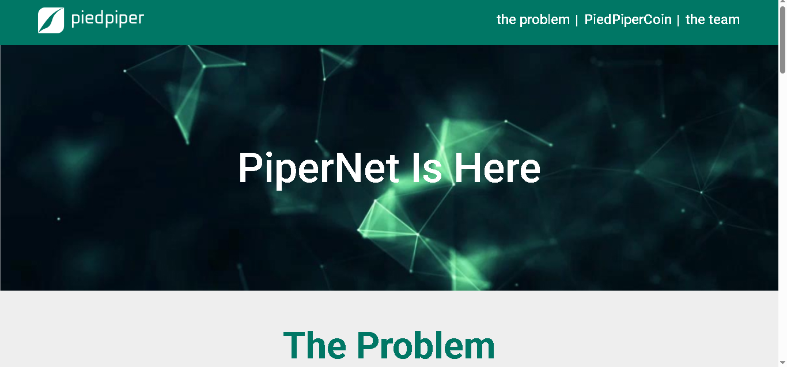

# Pied Piper — landing page

Одностраничный лендинг, практика верстки по БЭМ-методологии с использованием препроцессора стилей Sass

## Демо

🔗 [Открыть страницу](https://daryatash.github.io/scss-practice/)

## Описание

🔗 [Ссылка на макет](https://www.figma.com/community/file/1162468358517433148/diagram-pied-piper)

Верстка выполнена с использованием БЭМ-блоков, элементов и модификаторов. Адаптирована под мобильные экраны. Основная цель проекта - практика основ препроцессора стилей Sass. В проекте использованы базовые миксины и медиазапросы через миксины.